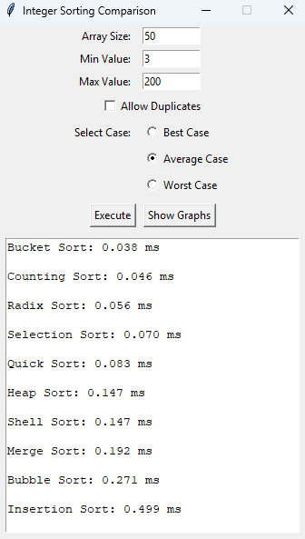
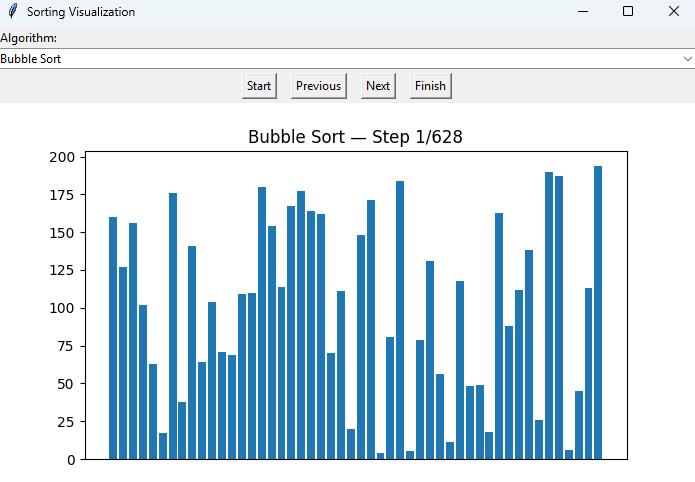

# Sorting Algorithm Visualization

A Python desktop application that visualizes sorting algorithms step by step and compares their execution times. Developed as part of my bachelor's thesis.

## Download (Windows)

1. Go to the [**latest release**](https://github.com/geovan102/sort-visualizer/releases/latest).
2. Download `sort-visualizer.exe` from the **Assets** section.
3. Double-click the file to run it. No Python installation is required.

If you use Linux or macOS, or prefer to run the application from source, see [Run from Source](#run-from-source).

## About

The project explores how different sorting algorithms behave with different input cases and array sizes, providing a visual way to understand their execution.

## Features

- Generate integer arrays with a custom size, minimum and maximum value.
- Choose whether duplicate values are allowed.
- Select the input case: Best, Average or Worst.
- Compare 10 sorting algorithms:
  - Bubble Sort
  - Selection Sort
  - Insertion Sort
  - Merge Sort
  - Quick Sort
  - Heap Sort
  - Counting Sort
  - Radix Sort
  - Bucket Sort
  - Shell Sort
- Visualize each algorithm step by step using bar charts.
- Measure and compare execution times in milliseconds.
- Navigate through the sorting steps using Start, Previous, Next and Finish controls.

## Tech Stack

- Python
- Tkinter
- Matplotlib

## Screenshots




## Getting Started

### Option 1: Run the Windows Executable

1. Visit the [latest GitHub Release](https://github.com/geovan102/sort-visualizer/releases/latest).
2. Download the `.exe` file.
3. Run the executable to launch the application.

No Python installation or additional dependencies are required.

### Option 2: Run from Source

#### Requirements

- Python 3.8 or newer
- Tkinter
- Matplotlib

Install Matplotlib:

```bash
pip install matplotlib
```

On some Linux systems, Tkinter may need to be installed separately:

```bash
sudo apt install python3-tk
```

#### Run the Application

1. Clone the repository:

   ```bash
   git clone https://github.com/geovan102/sort-visualizer.git
   cd sort-visualizer
   ```

2. Install the required dependencies.

3. Run the application:

   ```bash
   python sort-visualizer.py
   ```

## Usage

- **Array Size:** Choose the number of integers (1 to 500).
- **Min Value / Max Value:** Set the range of the generated numbers.
- **Allow Duplicates:** Allow or prevent duplicate values.
- **Select Case:** Choose Best (sorted ascending), Average (random) or Worst (sorted descending).
- **Execute:** Run all sorting algorithms and record their execution times and steps.
- **Show Graphs:** Open the visualizations and select an algorithm to explore its sorting steps.

Use the Start, Previous, Next and Finish buttons to navigate through the visualization.

## Project Structure

```text
sort-visualizer/
│
├── docs/
│   ├── graphical-user-interface.png
│   └── graphical-representation.png
│
├── .gitignore
├── LICENSE
├── Presentation.pdf
├── README.md
├── Thesis.pdf
└── sort-visualizer.py

## Implementation Notes

- Each algorithm stores its intermediate steps to support step-by-step visualization.
- Execution time is measured in milliseconds using `time.time()`.
- Radix Sort handles negative numbers by sorting negative and positive values separately.
- Invalid settings are checked before execution, including array size, value range and the number of available unique values.

## Known Limitations

- Large arrays (close to 500 elements) generate many steps and can take longer to visualize.
- Step navigation is basic and does not include smooth animations.
- There are no automated tests yet.

## License

This project is licensed under the MIT License. See the [LICENSE](LICENSE) file for details.

## Author

**Georgios Vanasas**
